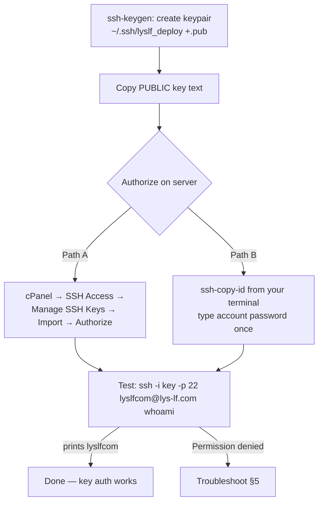

# SSH Access Setup — Bluehost cPanel (intricate walkthrough)

Goal: passwordless SSH into the Bluehost account so deploys + inspection run
non-interactively. Follow top→bottom; each step says what to expect.

Account facts (from [../INFRASTRUCTURE.md](../INFRASTRUCTURE.md)):
`user=lyslfcom`, `host=lys-lf.com` (IP `162.241.225.54`), `home=/home4/lyslfcom`,
`port=22`.

---

## Flow



---

## Step 1 — The key (DONE)

**Single key** for this project (all earlier generated/downloaded keys were
deleted to avoid sprawl):

| File | Type | Passphrase | Role |
|------|------|-----------|------|
| `~/.ssh/lyslf` (+`.pub`) | RSA 4096 | **yes** | The one lys-lf SSH key (login + deploy) |

- Generated **on the server** (`/home4/lyslfcom/.ssh/id_rsa`), downloaded, and
  installed locally as `~/.ssh/lyslf`.
- Fingerprint: `SHA256:zkfLwJqzTyIaH8OzBWb/qa7WfC60SUiVRC306VKKjcc`.
- **Passphrase lives ONLY in gitignored `../../.env`** as `SSH_KEY_PASSPHRASE`
  — never in this doc, never committed. Path + fingerprint also in `.env`
  (`SSH_KEY`, `SSH_KEY_FINGERPRINT`).

> It has a passphrase, so non-interactive use (deploy script, CI) requires an
> **ssh-agent** holding the decrypted key — see §8. For manual logins you'll
> just type the passphrase.

## Step 2 — Enable Shell Access (BLOCKER — currently OFF)

⚠ **Verified 2026-07-20: shell access is DISABLED on this account.** A
password login authenticates but the server returns *"Shell access is not
enabled on your account! If you need shell access please contact support."*
An authenticating account is NOT the same as one with a shell — sshd answers
for the whole shared box.

Until shell is enabled, **no SSH/rsync deploy works** (fall back to FTPS —
see [DEPLOY.agent.md](./DEPLOY.agent.md) / INFRASTRUCTURE §5).

To enable (WordPress Basic Hosting often needs this):
1. **Bluehost account dashboard** → **Hosting** → **Settings** / **Advanced**
   → look for **SSH Access** and toggle it on, OR
2. **Contact Bluehost support** and request shell/SSH access be enabled for
   `lyslfcom` (some plans require a ticket; a few basic plans don't offer SSH
   at all — confirm).

Re-test after enabling (Step 4). If SSH can't be enabled, the deploy pipeline
uses FTPS instead of rsync-over-SSH.

## Step 3 — Authorize the key on the server

The key was generated **on the server**, so its public half sits at
`~/.ssh/id_rsa.pub` there — but `ssh-keygen` does **not** add it to
`authorized_keys`. Authorize it (run in the server terminal / cPanel Terminal):
```bash
mkdir -p ~/.ssh && chmod 700 ~/.ssh
cat ~/.ssh/id_rsa.pub >> ~/.ssh/authorized_keys
chmod 600 ~/.ssh/authorized_keys
sort -u ~/.ssh/authorized_keys -o ~/.ssh/authorized_keys   # de-dupe
```
(Alternatively, cPanel → SSH Access → Manage SSH Keys → **Authorize** the key
if it's listed there.)

## Step 4 — Test from your machine
Passphrase key → load it into an agent first (see §8), then:
```bash
ssh -o IdentitiesOnly=no -p 22 lyslfcom@lys-lf.com "whoami && pwd && uname -a"
```
Expect: `lyslfcom`, `/home4/lyslfcom`, a Linux uname → key auth works.

## Step 5 — Troubleshooting

| Symptom | Cause | Fix |
|---------|-------|-----|
| `Permission denied (publickey)` | Key not authorized yet, or wrong key | Finish Step 3 (status must be **authorized**); confirm `-i` path |
| `UNPROTECTED PRIVATE KEY FILE` / `bad permissions` | Windows ACLs too open on the key | See §6 (Windows key perms) |
| `Connection timed out` | Wrong port / egress blocked | Try `-p 2222`; confirm port in cPanel → SSH Access |
| Asks for a password despite `-i` | Server didn't get the key, or offering password fallback | Re-run Step 3; add `-o IdentitiesOnly=yes -o PreferredAuthentications=publickey` |
| `Host key verification failed` | known_hosts mismatch | `ssh-keygen -R lys-lf.com` then reconnect |
| Works, but deploy script can't auth | `SSH_KEY` in `.env` wrong path | Set absolute git-bash path `/c/Users/boazs/.ssh/lyslf` |
| `Permission denied` right after generating on server | `.pub` not in `authorized_keys` | Run Step 3 on the server |

## Step 6 — Windows private-key permissions

Windows OpenSSH can reject a key that's readable by others. If Step 4 errors
on permissions, lock it down via PowerShell:
```powershell
icacls "$env:USERPROFILE\.ssh\lyslf" /inheritance:r
icacls "$env:USERPROFILE\.ssh\lyslf" /grant:r "$($env:USERNAME):(R)"
```
Then retry Step 4.

## Step 7 — `.env` wiring (DONE)

Repo-root `.env` (gitignored) holds all of it — docs/scripts reference these
keys, never the raw values:
```ini
SSH_HOST='lys-lf.com'
SSH_USER='lyslfcom'
SSH_PORT='22'
SSH_KEY='/c/Users/boazs/.ssh/lyslf'
SSH_KEY_PASSPHRASE='********'        # real value only in .env
SSH_KEY_FINGERPRINT='SHA256:zkfLwJqzTyIaH8OzBWb/qa7WfC60SUiVRC306VKKjcc'
```
These feed `scripts/deploy.sh` (see [DEPLOY.agent.md](./DEPLOY.agent.md)).

## Step 8 — Non-interactive use (passphrase key → ssh-agent)

Because the key has a passphrase, load it into an agent once per session so
`ssh`/`rsync`/the deploy script run without prompting:
```bash
eval "$(ssh-agent -s)"
ssh-add ~/.ssh/lyslf          # type the passphrase (from .env SSH_KEY_PASSPHRASE)
```
Now agent-authenticated commands work with no prompt. For **GitHub Actions**,
add `SSH_KEY_PASSPHRASE` as a secret and start an agent in the workflow (e.g. a
`ssh-agent` step) — a passphrase key cannot be used by `ssh -i` alone in CI.

---

## What happens after auth works

Once `whoami` returns `lyslfcom` (agent loaded per §8), the agent can inspect
the server read-only — e.g.:
```bash
ssh -p 22 lyslfcom@lys-lf.com \
  "ls -la ~ ; echo '--- public_html ---' ; ls -la ~/public_html | head -40"
```
Then we map what WordPress currently serves, plan the staging subdomain, and
wire up the first deploy.
