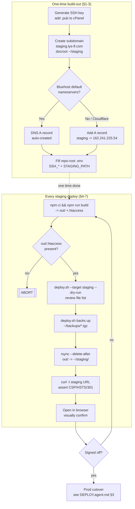
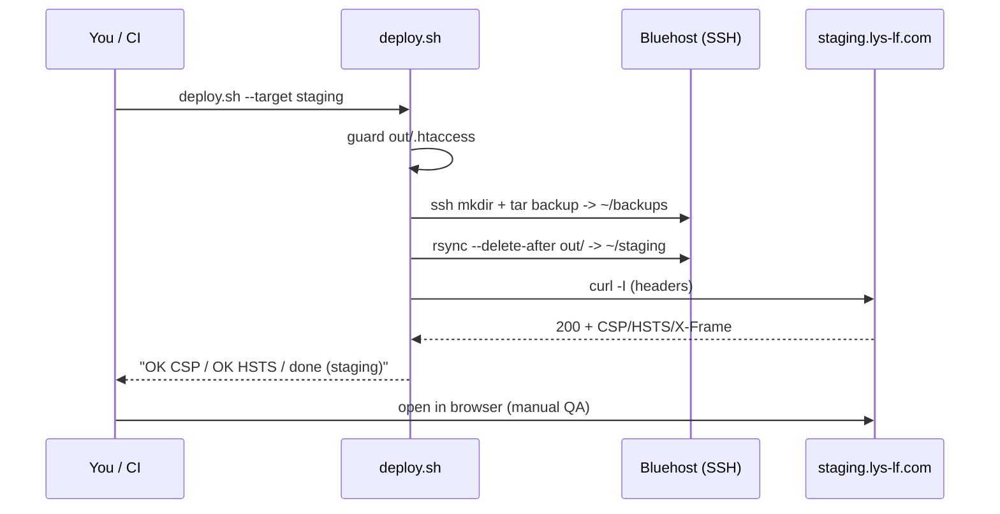

# Staging Deployment — step-by-step (developer guide)

How to stand up and deploy to **staging** for lys-lf.com, in enough detail
that you can follow it solo and know exactly where a failure happened.

Audience: you (the developer). Companion runbook (terse, agent-executable):
[DEPLOY.agent.md](./DEPLOY.agent.md). Infra facts: [../INFRASTRUCTURE.md](../INFRASTRUCTURE.md).
Risks: [../SECURITY.md](../SECURITY.md).

---

## 0. Current state (verified)

| Check | Result | Meaning |
|-------|--------|---------|
| `nslookup staging.lys-lf.com` | **NXDOMAIN** | Subdomain does **not** exist yet — must be created |
| `nslookup lys-lf.com` | `162.241.225.54` | Apex points at the Bluehost shared IP (live WP) |

So: **staging is not set up.** Sections 1–3 are the one-time build-out;
4–7 are every deploy after that.

---

## 1. Why a subdomain, not a `/staging/` subfolder

The site is a **static export** (`output: 'export'`). Its HTML references
assets with **absolute** paths — `/_next/static/...`, `/images/...`. Served
from `https://lys-lf.com/staging/`, the browser still asks for
`https://lys-lf.com/_next/...` (root), which doesn't exist there → every
script, style and image 404s. Fixing that needs `basePath: '/staging'` +
`assetPrefix` in `next.config.ts`, which you'd have to rip back out for prod.

A **subdomain served at its own root** (`https://staging.lys-lf.com/`) keeps
`basePath` empty. Same build works on staging and prod, unchanged.

> ⚠ **The staging docroot MUST live outside `public_html`** (use
> `/home4/lyslfcom/staging`). If it sat *inside* `public_html`, the
> production deploy's clean-mirror (`rsync --delete-after`) would delete it.
> Keeping it a sibling of `public_html` isolates the two completely.

---

## 2. Overview flow



---

## 3. One-time build-out

### Step 3.1 — SSH key (passwordless, safe deploys)
On your machine:
```bash
ssh-keygen -t ed25519 -C "deploy@lys-lf" -f ~/.ssh/lyslf_deploy -N ""
cat ~/.ssh/lyslf_deploy.pub          # copy the PUBLIC key text
```
Install the **public** key on the server:
- cPanel → **SSH Access** → **Manage SSH Keys** → **Import Key** → paste the
  `.pub` contents → then **Authorize** it.
- Keep the private key `~/.ssh/lyslf_deploy` secret (never commit).

Test:
```bash
ssh -i ~/.ssh/lyslf_deploy -p <SSH_PORT> lyslfcom@lys-lf.com "whoami"
# expect: lyslfcom
```
> Don't know the port? cPanel → **SSH Access** shows it (Bluehost is usually
> `22`). Put it in `.env` as `SSH_PORT`.

### Step 3.2 — Create the subdomain

**Option A — cPanel UI (simplest):**
cPanel → **Domains** → **Create A New Domain** (or **Subdomains**) →
- Domain: `staging.lys-lf.com`
- Document Root: `/home4/lyslfcom/staging`  ← outside public_html (see §1 warning)
- Create.

**Option B — over SSH (if you prefer CLI):**
```bash
ssh -i ~/.ssh/lyslf_deploy -p <PORT> lyslfcom@lys-lf.com \
  "uapi SubDomain addsubdomain domain=staging rootdomain=lys-lf.com dir=staging"
```
(`dir=staging` → docroot `/home4/lyslfcom/staging`.)

### Step 3.3 — DNS record
- **Bluehost default nameservers:** creating the subdomain **auto-adds** the
  DNS A record → `162.241.225.54`. Nothing more to do.
- **External DNS (e.g. Cloudflare — confirm in INFRASTRUCTURE.md §3):** add an
  **A record** `staging` → `162.241.225.54` yourself. If proxied (orange
  cloud), TLS still works; grey-cloud is simplest for first setup.

Verify propagation (may take minutes to an hour):
```bash
nslookup staging.lys-lf.com          # expect 162.241.225.54
```

### Step 3.4 — TLS certificate
Bluehost AutoSSL usually issues a cert for a new subdomain within ~an hour.
Check cPanel → **SSL/TLS Status**; if not covered, click **Run AutoSSL**.
Until the cert lands, `https://staging.lys-lf.com` may warn — that's expected.

### Step 3.5 — Fill `.env` (repo root, gitignored)
```ini
SSH_HOST='lys-lf.com'
SSH_USER='lyslfcom'
SSH_PORT='22'                        # your real port
SSH_KEY='~/.ssh/lyslf_deploy'        # PRIVATE key path
STAGING_PATH='/home4/lyslfcom/staging'
VERIFY_URL_STAGING='https://staging.lys-lf.com'
```

---

## 4. Build

```bash
cd lys-lf-react-19
npm ci
npm run build
test -f out/.htaccess && echo "htaccess OK" || echo "ABORT: no .htaccess"
```
`out/` now holds the full static site + the security `.htaccess`.

## 5. Dry-run (mandatory — look before you leap)

```bash
scripts/deploy.sh --target staging --dry-run
```
Reads `.env`, connects over SSH, prints the rsync file list **without
changing anything**. First run = all files "new" (staging is empty). Later
runs = only changed files. A surprise mass-delete means you pointed at the
wrong dir — stop.

## 6. Deploy

```bash
scripts/deploy.sh --target staging
```
What the script does, in order:
1. Loads `.env`, resolves `STAGING_PATH`.
2. Guards `out/` and `out/.htaccess` exist (else abort).
3. `ssh ... mkdir -p ~/staging ~/backups`.
4. Backs up current staging → `~/backups/deploy-staging-<timestamp>.tgz`.
5. `rsync -az --delete-after out/ → ~/staging/` (dotfiles included, clean mirror).
6. Curls `VERIFY_URL_STAGING`, asserts CSP / HSTS / X-Frame-Options.

## 7. Verify



Manual QA checklist:
- [ ] Home renders; header background image loads.
- [ ] Team, Practice Areas, Business Profile, Contacts sections present.
- [ ] Google Map tile loads (Maps key referrer must allow `staging.lys-lf.com` — see SECURITY.md APP-3).
- [ ] `/privacy` loads.
- [ ] A bogus path (`/nope`) shows the custom 404.
- [ ] `curl -I https://staging.lys-lf.com` shows CSP + HSTS; `http://` → 301 `https://`.

## 8. After sign-off → production

Staging is throwaway. When approved, cut over to prod (replaces WP) per
[DEPLOY.agent.md §3](./DEPLOY.agent.md). Same script, `--target prod`.

---

## 9. Troubleshooting — where people get stuck

| Symptom | Cause | Fix |
|---------|-------|-----|
| `Permission denied (publickey)` | Public key not authorized, or wrong `SSH_KEY` path | Re-check cPanel SSH key is **Authorized**; test `ssh -i ... whoami` |
| `Could not resolve host` / NXDOMAIN | DNS not created/propagated | Wait; verify subdomain exists (§3.2); external DNS needs manual A record (§3.3) |
| Page loads but **CSS/JS/images 404** | Deployed to a subfolder, not a subdomain root | Use the subdomain docroot; don't serve from `/staging/` path (§1) |
| `403 Forbidden` at subdomain root | No `index.html` in docroot, or docroot wrong | Confirm `~/staging/index.html` exists after rsync; check subdomain docroot = `STAGING_PATH` |
| `ABORT: out/.htaccess missing` | Build didn't copy `public/.htaccess` | Ensure `public/.htaccess` exists; rebuild; don't hand-edit `out/` |
| Security headers missing on staging | `.htaccess` not uploaded (hidden) or Apache module off | Confirm `~/staging/.htaccess` present; rsync includes dotfiles by default |
| rsync wants to **delete lots of files** | Wrong `STAGING_PATH` (pointed at real content) | Abort. Fix `STAGING_PATH`. Never `--target prod` unless cutover |
| HTTPS cert warning on staging | AutoSSL hasn't issued yet | cPanel → SSL/TLS Status → Run AutoSSL; wait |
| Map blank on staging | Maps API key referrer restriction excludes staging host | Add `staging.lys-lf.com/*` to the key's allowed referrers (GCP) |

## 10. Rollback

```bash
ssh -i ~/.ssh/lyslf_deploy -p <PORT> lyslfcom@lys-lf.com \
  'ls -t ~/backups/deploy-staging-*.tgz | head -1'
# then restore that tarball into ~/staging (see DEPLOY.agent.md §4)
```
Staging is disposable, so usually you just rebuild and redeploy instead.
